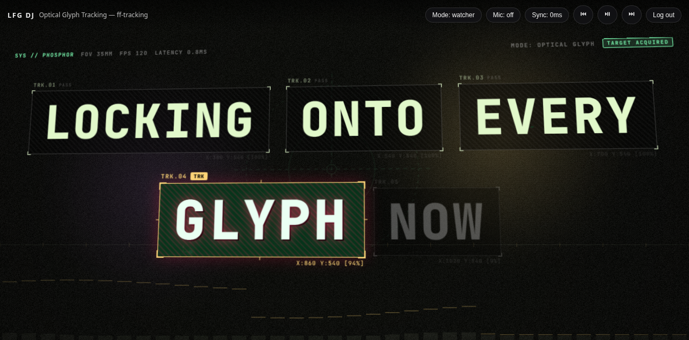

# LFG-DJ



Play a song on Spotify and this thing turns your screen into a high-energy, responsive **kinetic typography visualizer**. Rhythmic, dynamic typography animations slam, cut, flow, and breathe in sync with your playback, lyrics, and room audio.

It's a lightweight Tauri desktop app. You log in once with your Spotify account, hit play on any device (or inside the app), and the kinetic typography engine does the rest.

## Running it

You need a free Spotify app Client ID first — see **[SETUP.md](SETUP.md)**. Then:

```bash
pnpm install
pnpm tauri dev    # desktop app
# or: pnpm dev    # frontend-only preview in a browser
```

Type-check without building: `pnpm typecheck`.
Production build: `pnpm build`.


## How it fits together

```
Spotify (your account)
   │            │
   │  Watcher:  │  SDK mode:
   │  "what's   │  app is a Connect
   │  playing?" │  device itself
   ▼            ▼
 player.ts ──► state.ts ──► window.__dj / __djState  (published every frame)
                        │
   lyrics.ts ── LRClib ──┤      mic.ts ── getUserMedia FFT
                        ▼
        ┌───────────────────────────────┐
        │ kinetic/KineticLayer ──► #root│  Kinetic Typography + Ambient Glow
        │ ui/overlay ──► #overlay       │  chips/toasts (top controls)
        └───────────────────────────────┘
```

One lightweight loop drives it: every animation frame the app interpolates the playback position, picks the active lyric line, samples the mic, and publishes state.

- **`kinetic/KineticLayer.tsx`** — Renders dynamic kinetic typography scenes over an ambient beat-reactive backdrop.
- **Pure GPU-composited CSS3 Transforms & Layouts** — runs at locked 60/120 FPS with minimal CPU/GPU overhead (no heavy 3D shaders or bloated runtime dependencies).

## What it does

- **Two ways to hear Spotify.** *Watcher* mode polls your account and works with playback on any device (no Premium needed). *SDK* mode turns the app into a real Spotify Connect device for tight sync (Premium required).
- **Synced lyrics** from [LRClib](https://lrclib.net), converted into real **kinetic text animations** dynamically selected per line:
  - **Staccato Burst**: Syllable cuts flashing with explosive kinetic impacts and context line.
  - **Whip Directional Slam**: High-velocity directional whip-pan entrance with kinetic skew.
  - **Inverted Color Strobe**: High-contrast block snap with active word inversion.
  - **Word Cascade Stack**: Words slamming down sequentially into a vertical rhythm stack.
  - **Perspective 3D Snap**: Athletic 3D camera tilt and solid extrusion depth.
  - **Dynamic Scale Ramp**: Speed-ramp zoom tracking sung syllables in real time.
  - **Optical Glyph Tracker (ff-tracking)**: Monospace optical glyph bounding boxes with diagonal scanline hatching, telemetry reticles, and vector connector tracer lines.
- **Continuous Beat Reactive Groove**: Continuous musical oscillation and mic FFT modulation that keeps text grooving with the rhythm rather than hitting and stopping.
- **Deterministic Moods**: Color palettes derived deterministically per track from its title and artist.
- **Stays logged in**: refresh token persisted; access tokens renew themselves.

## Stack

- **Tauri 2** (Rust shell + WebView) — desktop window, secure refresh-token store
- **Vite + TypeScript + React 19** — lightweight frontend (< 100 KB gzipped)
- **Spotify Web Playback SDK** — SDK-mode playback
- **Spotify Web API** — watcher polling + transport, via OAuth PKCE
- **LRClib** — synced/plain lyrics
- **`getUserMedia` + `AnalyserNode`** — mic FFT
- **`@fontsource/archivo-black` + `space-grotesk`** — display & grotesque typography

## Files

```
index.html              #root (React) + #overlay; CSP for spotify/lrclib
assets/
  preview.png           preview screenshot
src/
  main.tsx              bootstrap + the rAF loop + React root mount
  App.tsx               renders <KineticLayer/>
  state.ts              app state + publishes window.__dj/__djState each frame
  auth.ts               Spotify OAuth PKCE (paste your Client ID here)
  player.ts             watcher polling + Web Playback SDK + transport
  lyrics.ts             LRClib fetch, multi-timestamp LRC parse, active-line picking
  mic.ts                getUserMedia + AnalyserNode → energy/bands
  ui/overlay.ts         top-bar chips, login pane, toasts
  styles/               base + overlay + lyric-layer CSS
  kinetic/
    types.ts            type definitions for signals and archetypes
    archetypes.ts       dynamic kinetic archetype selector (7 styles)
    timing.ts           pure math easing, continuous beat clock & word-level timing helpers
    mood.ts             deterministic per-track color palette generator
    signalStore.ts      reactive store over __djState
    AmbientBackground.tsx  lightweight beat-reactive ambient glow
    KineticScene.tsx    kinetic typography renderer (7 archetypes + camera rig)
    KineticLayer.tsx    fullscreen layer mounting scene + background
src-tauri/
  tauri.conf.json       window config, app id com.lfgdj.app
  src/lib.rs            refresh-token save/load/clear commands
SETUP.md                how to get a Client ID and run it
```

## Running it

You need a free Spotify app Client ID first — see **[SETUP.md](SETUP.md)**. Then:

```bash
pnpm install
pnpm tauri dev    # desktop app
# or: pnpm dev    # frontend-only preview in a browser
```

Type-check without building: `pnpm typecheck`.
Production build: `pnpm build`.
